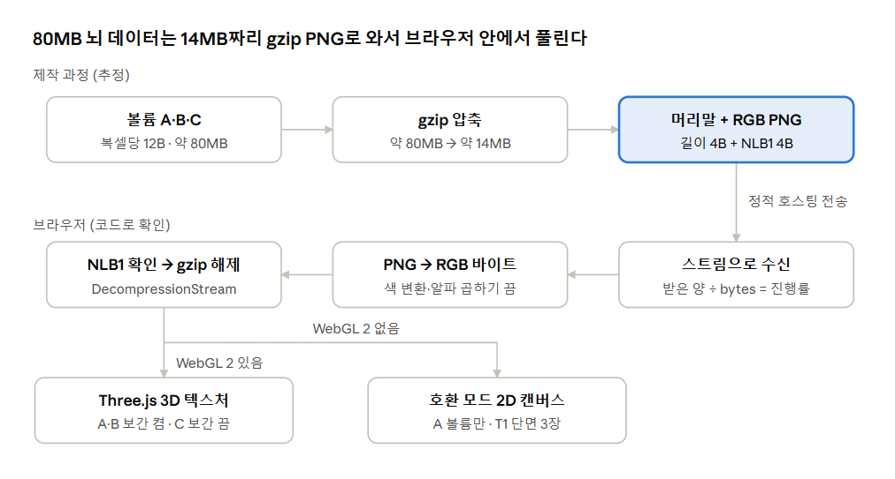

# NeuroLightbox 분석 노트

> 이 문서는 공개 사이트 [NeuroLightbox](https://neurolightbox.netlify.app/)를 학습 목적으로 관찰·분석한 개인 노트입니다. 원본 코드와 데이터의 권리는 제작자에게 있으며, 이 저장소에는 포함하지 않습니다.

Oct 28, 2026 · @엄태은

NeuroLightbox는 프레임워크 없이 HTML 한 파일과 Three.js로 만든 신경영상 교육 사이트이며, 23MB 뇌 데이터를 gzip으로 압축해 PNG 픽셀에 담아 전송한다.

## 분석 개요

- **대상**: [NeuroLightbox](https://neurolightbox.netlify.app/) — MRI·CT·PET 등 9가지 신경영상 기법을 3D로 체험하는 의학·신경과학 학습용 웹사이트 (Netlify 정적 호스팅)
- **목적**: 스크롤에 따라 3D로 변하는 연출과 대용량 뇌 데이터 전송 방식을 이해하고, 내 의료 AI 웹 포트폴리오에 응용할 기법을 찾기
- **도구**: [REA](https://github.com/morluto/rea) 6.8.0 (CDP 기반 웹 관찰), 크롬 개발자 도구 Network 탭, 터미널 `curl` · `file` · `grep` · `sed`
- **환경**: MacBook Pro (M1 Pro), Node.js 26.12.1 (nvm), 분석 전용 크롬 프로필 + 원격 디버깅 포트 9222

**지킨 원칙**

- 공개 사이트를 평범하게 방문하며 브라우저에 내려온 것만 관찰했다. 숨은 경로 탐색이나 반복 요청은 하지 않았다.
- 내려받은 `vol.png`, `index.html` 등은 개인 분석용 사본이며 재배포하거나 GitHub에 올리지 않는다.
- 이 노트는 원리를 내 말로 정리한 것이고, 코드 인용은 설명에 필요한 짧은 조각으로 제한했다.
- 원격 디버깅 크롬은 로그인 없는 빈 프로필로 띄우고, 분석 후 종료한다.

## 분석 과정

도구 선택 실수 두 번을 거쳐, 개발자 도구로 데이터 파일을 찾고 `grep`으로 해독 코드를 읽는 순서가 가장 빨랐다.

1. **환경 준비** — nvm으로 Node.js 26 설치 중 Xcode 라이선스 미동의로 git이 막힘 → `sudo xcodebuild -license` 동의 후 해결. `npm install --global rea-agents`로 REA 설치, `rea doctor`로 점검(네이티브 분석 엔진은 웹 분석에 불필요).
2. **관찰용 크롬** — `--remote-debugging-port=9222 --user-data-dir=~/rea-chrome-profile`로 분리된 프로필 실행, `rea list-browser-targets`로 탭 ID 확인.
3. **페이지 관찰** — `rea inspect-web-page`(5초)로 DOM 1,076개, 스크립트 9개 확인 → Three.js와 후처리 부품, 68만 자 인라인 스크립트 발견. 네트워크 기록은 연결 이전 활동이라 비어 있었음.
4. **시행착오 ①** — 관찰 중 새로고침 → `target_changed` 오류. `inspect-web-page`는 고정된 문서만 관찰한다.
5. **시행착오 ②** — `rea observe-web-session`은 주소 이동만 기록하고 네트워크 요청은 남기지 않는다. 해시 라우팅(`#ct`)만 확인.
6. **데이터 파일 발견** — 크롬 개발자 도구 Network 탭(Disable cache) → `vol.png` 14MB, `mesh.png` 8.7MB, `jue.png` 100KB, `meta.json` 7KB, 모두 `(index):2137`에서 요청.
7. **설계도 해독** — `meta.json` 원문으로 차원·부위·메쉬 오프셋 구조 파악.
8. **PNG 정체 확인** — `curl`로 내려받아 `file` → 2048 × 2277 RGB, 미리보기는 균일한 노이즈 → "압축 데이터를 담은 PNG"로 추정.
9. **코드 읽기** — `curl`로 `index.html` 저장 후 `grep -n`으로 키워드 줄 번호 찾기, `sed -n '시작,끝p'`로 구간 잘라 읽기. 제작자 주석과 `fetchBin` 함수로 전 과정 확정.

> 교훈: REA 같은 자동 도구보다 브라우저 개발자 도구와 `grep`이 웹 분석의 기본기다. 도구는 설명서(`--help`)를 먼저 읽고 쓴다.

## 전체 구조

빌드 도구나 프레임워크 없이, 여러 파일로 개발한 코드를 `index.html` 한 파일로 합쳐 배포한 구조다(`/* buildMRI lives in imm_mri.js */` 주석이 흔적).

| 구성 요소 | 내용 | 근거 |
| --- | --- | --- |
| 페이지 | HTML + 인라인 CSS(약 6만 자) + 인라인 JS(약 68만 자, 8,000줄 이상) | DOM 관찰, 다운로드 227KB(압축 전송) |
| 프레임워크 | 없음 (바닐라 JS, `$()`를 직접 만든 선택자 함수로 사용) | 스크립트 목록 |
| 화면 전환 | 해시 라우팅 — `#ct`처럼 `#` 뒤만 바꿔 같은 문서 안에서 화면 교체 | `same_document_navigation` |
| 3D | `vendor/three/three.min.js`(603KB) 자체 호스팅, 모듈이 아닌 `<script>` 방식 | 스크립트 목록 |
| 후처리 | EffectComposer · RenderPass · ShaderPass · MaskPass · CopyShader | 스크립트 목록 |
| 대체 경로 | WebGL 2 실패 시 2D 캔버스로 T1 단면 3장만 보여주는 호환 모드 | `load()`, `loadCompatibilityPreview` |
| 외부 리소스 | Google Fonts 글꼴 3개 | Network 탭 |
| 호스팅 부가 | Netlify RUM(방문 속도 측정), HUD 스크립트 — 사이트 기능과 무관 | `.netlify/scripts/*` |

9가지 기법 챕터(mri, ct, pet, spect, fmri, eeg, meg, us, dsa)는 하나의 등록표에 이름·스크롤 길이·조립 함수로 등록돼 있다(렌더 엔진과 성능 절 참고).

## 데이터 파이프라인

약 80MB의 복셀 데이터를 gzip으로 약 14MB까지 줄이고, 그 바이트를 RGB PNG 픽셀에 담아 정적 호스팅으로 보낸다. 브라우저는 내장 `DecompressionStream`만으로 푼다.



윗줄은 meta.json과 파일 크기로 추정한 제작 과정, 아랫줄은 `fetchBin` 코드로 확인한 해독 과정이다.

### 받는 파일

| 파일 | 크기 | 정체 |
| --- | --- | --- |
| `data/vol.png` | 13,953,635 B | 볼륨 3개(A·B·C)를 gzip해 담은 PNG, 2048 × 2277 RGB |
| `data/mesh.png` | 8,679,409 B | 부위별 3D 메쉬 117조각의 이진 데이터 |
| `data/jue.png` | 99,407 B | Juelich 아틀라스 번호 지도(`VOL.J`) |
| `data/meta.json` | 약 7KB | 설계도: 차원, 부위 사전, 메쉬 오프셋, 랜드마크, 파일 크기 |

### PNG 데이터 형식 (`fetchBin`)

제작자 주석: *gzip bytes stored losslessly in PNG pixels (RGB, 8-byte header)*.

| 위치 | 내용 |
| --- | --- |
| 0–3 바이트 | 실제 데이터 길이 (리틀 엔디언 32비트 정수) |
| 4–7 바이트 | 매직 넘버 `NLB1` — 자기 형식인지 확인 |
| 8 바이트\~ | gzip 데이터 (`1f 8b`로 시작하면 해제, 아니면 그대로 사용) |
| 끝부분 | 픽셀 줄을 채우고 남은 빈 칸 → 길이 값으로 잘라 버림 |

해독 순서: 스트림으로 조각 수신(진행률 갱신) → `createImageBitmap(blob, {colorSpaceConversion:'none', premultiplyAlpha:'none'})` → 캔버스에 그려 `getImageData` → RGBA에서 RGB만 추출 → 머리말 확인 → gzip 해제.

- **RGB만 쓰는 이유**: 알파 채널이 있으면 브라우저가 RGB를 알파에 맞춰 미리 곱해(premultiplied alpha) 값이 바뀔 수 있다.
- **색 변환을 끄는 이유**: 모니터 색 특성 보정이 1만 바꿔도 압축 데이터 전체가 깨진다.
- **압축 확인**: 픽셀 용량 2048 × 2277 × 3 = 13,989,888 B ≈ 파일 크기 → PNG 자체 압축이 거의 0, 내용이 이미 압축됐다는 증거.

### 볼륨 구성 (복셀당 12바이트)

복셀 수 n = 180 × 213 × 173 = 6,632,820, 해제 후 n × 12 ≈ 79.6MB.

| 볼륨 | 4개 값 | 텍스처 보간 |
| --- | --- | --- |
| A | T1 밝기, 회백질, 백질, 뇌척수액 (각 0–255 → /255 비율) | 켬 |
| B | 뼈, 두개강 내부 마스크(0/1), (미사용 확인 안 됨), 공기 | 켬 |
| C | 코드에서 직접 읽지 않음 — 아틀라스 번호로 추정 | 끔 |

C만 보간을 끈 것은 번호 데이터에 맞는 선택이다. 41번과 43번 사이를 섞으면 엉뚱한 42번 부위가 된다.

### 메쉬 바이트 배치 (`meta.json`의 `pieces`)

각 조각은 `nv`(꼭짓점 수), `nf`(삼각형 수), `pos` · `nrm` · `idx`(mesh 데이터 안 시작 위치)를 가진다. 1번 조각(nv 27,200, nf 53,230)으로 검산하면 나눗셈이 정확히 떨어진다.

| 구간 | 바이트 | 단위당 | 해석 |
| --- | --- | --- | --- |
| 좌표 | 163,200 | 6 B / 꼭짓점 | x·y·z를 2바이트 정수로 양자화 |
| 법선 | 108,800 | 4 B / 꼭짓점 | 표면 방향 압축 저장 |
| 인덱스 | 638,760 | 12 B / 삼각형 | 꼭짓점 번호 3개 × 4바이트 |

- 깊은 구조(97–113번)는 모두 삼각형 약 3,000개 → 일정 개수로 단순화한 흔적.
- 43·91번(두정덮개)은 `centroid`도 메쉬도 없음 → 이 뇌에서 빈 부위.
- 마지막 조각 `id: 0`(꼭짓점 18,002개)은 배열 116번째이고 `scalpIndex: 116` → 두피 메쉬.

### meta.json의 나머지

- `calib`: 원본 MRI에서 뇌척수액 0.204, 회백질 0.517, 백질 0.760 밝기 기준값 → 조직별로 다시 칠해 다른 기법을 흉내 내는 데 쓰는 것으로 추정
- `regions`: Harvard-Oxford 피질 48개 × 좌우 + 피질하·뇌간·소뇌·뇌실 = 118개, 엽 그룹과 무게중심(MNI mm)
- `jhu` 47개 백질 신경로, `juelich` 103개 세부 구역, `yeo` 7개 네트워크 이름
- `landmarks`: 상시상정맥동 경로 30점, 뇌량·섬엽·뇌간 기준점, EEG 10-20 전극 19개 좌표
- `bytes`: 진행률 계산의 분모 (`got / META.bytes.vol`)

## 좌표계와 단면 렌더링

밀리미터 단위 MNI 좌표를 복셀 번호로 바꾸는 기준점은 (90, 126, 72)이며, 잘라낸 시작 위치 `lo` = (1, 4, 4)만큼 빼서 쓴다.

### mm → 복셀 번호 (`compatPlanePosition`)

```latex
k_{axial} = \mathrm{round}(z_{mm} + 72) - lo_z \qquad j_{coronal} = \mathrm{round}(y_{mm} + 126) - lo_y \qquad i_{sagittal} = \mathrm{round}(90 - x_{mm}) - lo_x
```

- (90, 126, 72)는 MNI 1mm 격자에서 좌표 (0, 0, 0)mm가 놓인 칸이다.
- 좌우(x)만 부호가 뒤집혀 있다. 의료 영상의 좌우 방향 규칙 차이를 맞춘 것이다.
- 결과는 `Math.max(0, Math.min(최대-1, …))`로 볼륨 범위 안에 묶는다.

### 3D 위치 → 1차원 배열 위치

```latex
src = ((k \cdot h + j) \cdot w + i) \cdot 4
```

x가 가장 빨리, 그다음 y, z 순서로 한 줄로 늘어선 배열이다. 끝의 × 4는 복셀당 값 4개(A 볼륨)를 뜻한다.

### 단면 그리기 (`compatibilitySlice`)

- **빈 공간 건너뛰기**: 회백질 + 백질 + 뇌척수액 합이 8 미만이면 뇌 밖으로 보고 투명 처리
- **감마 보정**: 회색값 = 18 + 230 × (T1/255)^0.82, 14–248로 제한 → 중간 밝기를 살짝 올려 구조가 잘 보이게 함
- **필름 톤**: 초록 채널에 +2 → 약간 푸르스름한 느낌
- **방향 맞추기**: axial은 `j = h-1-y`, coronal·sagittal은 `k = d-1-y`로 위아래를 뒤집어 화면 위쪽이 앞·위쪽이 되게 함
- **캐싱**: `"axial:85"` 같은 키로 그린 단면을 `Map`에 저장 → 슬라이더를 되돌려도 다시 계산하지 않음

## 스크롤 3D 연출

긴 섹션 안에 화면 크기 영역을 `position: sticky`로 고정하고, 스크롤 거리를 0–1 진행률 p로 바꿔 3D 장면과 설명 글을 p의 함수로 그린다.

### 진행률 계산

```latex
p = \mathrm{clamp}\left(\frac{-\,top_{section}}{height_{section} - height_{pinned}},\ 0,\ 1\right)
```

섹션 윗변이 화면 위로 올라간 거리를, 실제로 스크롤할 수 있는 거리로 나눈다. 홈 화면은 고정 높이로 브라우저 창 높이(`innerHeight`)를 쓴다.

### 설명 글: data 속성 + smoothstep

- 각 문단에 `data-a`(나타나는 p), `data-b`(사라지는 p)를 적어둔다. 예: MRI 0.42–0.5, CT 0.5–0.58로 이어 붙임
- 마지막 문단은 `data-b="1.01"` → p가 1이어도 사라지지 않게 하는 트릭
- 투명도 = min(나타나기, 1 − 사라지기), 각각 smoothstep으로 0.025(홈) 또는 0.012(챕터) 구간에서 변화
- 투명도와 함께 위아래로 14–16px 이동 → 밋밋하지 않은 등장

```latex
\mathrm{smoothstep}(a, b, x) = t^2(3 - 2t), \quad t = \mathrm{clamp}\left(\frac{x - a}{b - a}, 0, 1\right)
```

### 회전: 쿼터니언 + slerp

- 뇌의 방향을 쿼터니언(숫자 4개로 표현한 회전)으로 다뤄 짐벌 락을 피한다.
- 기준 자세 두 개를 키프레임처럼 정해두고(`Q34` 비스듬한 보기, `QSAG` 옆모습) slerp로 최단 경로를 따라 부드럽게 오간다.

### 홈 화면 대본 (`heroApply`)

| 진행률 p | 일어나는 일 |
| --- | --- |
| 0 – 0.16 | 뇌가 서서히 나타나며 다가옴 (투명도 + 카메라 값) |
| 0 – 0.27 | 약 −1.7 rad 누워 있던 뇌가 회전해 정면을 향함 |
| 0.25 – 0.38 | 옆모습으로 돌아가며 x = −7mm 시상면 단면을 드러냄 |
| 0.36 – 0.45 | 둥근 돋보기가 오른쪽에서 감속하며 들어옴 (`easeOut`) |
| 0.45 – 0.84 | 돋보기가 뇌를 훑고, 안쪽 화면이 `HERO_CYCLE` 표에 따라 기법별로 바뀜 |
| 0.84 – 0.90 | 돋보기가 가속하며 퇴장 (`gOut²`) |
| 0.86 – 1.0 | 뇌가 처음의 비스듬한 각도로 복귀 |

- 주석은 돋보기가 "왼쪽으로 떠난다"고 하지만 코드는 오른쪽 바깥(`stageW + 40`)으로 보낸다. 연출을 바꾸고 주석을 안 고친 흔적.
- 화면 폭 640px 미만이면 돋보기를 크게, 가운데로 → 반응형.
- 기법이 바뀌는 순간에만 Web Animations API로 0.65초 쓸고 지나가는 효과, 동작 줄이기 설정이면 0초.

### 챕터 몰입 화면 (`immTick`, `immJump`, `immLabels`)

- 진행 막대와 SVG 원 진행 표시: 원 둘레 100.53(= 2π × 16)을 `strokeDashoffset`으로 밀어 채움
- 원 버튼을 누르면 다음 설명 글 시작 위치로 `scrollTo`, `prefers-reduced-motion`이면 즉시 이동
- 터치 기기(`hover: none`)면 안내 문구를 "Scroll"에서 "Swipe up"으로 교체
- 3D 이름표: `vector.project(camera)`로 3D 점을 −1–1 화면 좌표로 바꾼 뒤 픽셀로 환산, HTML 글자를 캔버스 위에 겹쳐 선명하게 표시. 카메라 뒤(`z > 1`)나 화면 밖이면 숨김

## 렌더 엔진과 성능

공통 엔진 하나가 챕터 등록표의 `build` 함수를 불러 3D 세계를 조립하고, 화면에 보일 때만 그리며, 느리면 스스로 품질을 낮춘다.

### 데이터 주도 설계

- **챕터 등록표**: `mri:{ label, height:1100, build:buildMRI, deepTitle, hud }`처럼 9개 기법을 한 객체에 등록. `height`는 스크롤 길이(MRI 1100으로 최장, SPECT·EEG·MEG·US 950)
- **인터페이스**: 제작자 주석 `build(scene, renderer, R) → {update(p, t, dt), labels(p)}` — 이 모양만 지키면 엔진이 어떤 챕터든 똑같이 다룬다
- **단위 규칙**: 장비 장면은 cm, 각 장비의 아이소센터가 원점. 뇌·두피·혈관·전극은 MNI mm 그룹으로 넣고 누운 자세(MRI·CT) 또는 앉은 자세(EEG·MEG)로 배치
- **연출 표**: 홈 화면 `HERO_CYCLE`, 카드 `METHOD_CARD`도 표로 관리 → 새 기법은 표에 한 줄 + build 함수 하나로 추가

### 매 프레임 루프

1. 섹션이 화면에 없거나 다른 화면이면 그리지 않음 (`IntersectionObserver`)
2. 프레임 간격 `dt`를 최대 0.1초로 제한 → 탭 전환 후 순간이동 방지
3. `world.update(p, t, dt)` → 스크롤 진행률과 시간으로 장면 갱신 (멈춰 있어도 천천히 움직이는 연출 가능)
4. 품질 단계에 따라 후처리 합성 또는 기본 렌더
5. 3D 이름표 위치 갱신

### 성능 장치

| 장치 | 방법 | 효과 |
| --- | --- | --- |
| 스크롤 처리 | `cancelAnimationFrame` 후 다시 예약, 값이 같으면 건너뜀 | 스크롤 이벤트 수백 번을 프레임당 1번으로 |
| `{passive:true}` | 스크롤을 막지 않는다고 브라우저에 약속 | 즉시 스크롤, 끊김 감소 |
| dirty 플래그 | 바뀌었을 때만 `dirty = true`, 루프는 그때만 그림 | 정지 화면에서 발열·배터리 절약 |
| 해상도 상한 | `devicePixelRatio`를 최대 1.5로 | 레티나에서 픽셀 수 폭증 방지 |
| 적응형 품질 | 30프레임 평균이 0.034초(약 29fps) 초과 시 SAO 끄기 → 해상도 ×0.85씩(최저 0.7) → 후처리 끄기 | 저사양 기기에서도 부드럽게 |
| 품질 스위치 | 주소에 `?q=low` / `?q=mid` | 개발자 테스트용, 자동 조절 중지 |
| 메모리 정리 | 챕터를 떠날 때 geometry·material·texture `dispose()`, `forceContextLoss()` | 해시 라우팅 구조에서 GPU 메모리 누수 방지 |

### 후처리: 필름 질감

주석 순서 그대로: MSAA(계단 현상 제거) half-float 렌더 타깃 → SAO(주변광 차폐, 입체감) → sRGB 변환, 비네트(가장자리 어둡게), 그레인(미세 노이즈), 렌즈 색번짐. SAO 부품(`SAOPass.js`)은 받은 스크립트 목록에 없어서, `if` 방어 코드로 건너뛰고 나머지만 적용되는 것으로 보인다.

### 호환 모드

WebGL 2 컨텍스트를 못 얻으면 실패 원인·브라우저 정보를 남기고 `loadCompatibilityPreview`로 전환한다. A 볼륨만 잘라 2D 캔버스로 "three orthogonal T1 slices"를 보여주고, 데이터가 설계도보다 짧으면 바로 오류를 낸다.

## 배운 점과 적용할 기법

가장 가져갈 만한 것은 "의료 영상 데이터를 서버 없이 정적 웹에서 빠르게 보여주는 법"과 "스크롤 진행률 하나로 3D 설명을 이끄는 법"이다.

**내 프로젝트에 쓸 기법**

- **정적 호스팅용 데이터 포장**: NumPy 볼륨 → gzip → 머리말(길이 + 매직 넘버) → RGB PNG. GitHub Pages에도 그대로 올릴 수 있다.
- **브라우저 내장 해제**: `DecompressionStream('gzip')` + `createImageBitmap`의 색 변환·알파 곱하기 끄기
- **스트림 진행률**: `response.body.getReader()`로 받은 양을 세어 로딩 막대 표시
- **설계도 JSON 분리**: 차원·라벨 사전·오프셋을 `meta.json`에 두고 바이너리는 숫자만
- **스크롤리텔링**: sticky 고정 + 진행률 p + `data-a/b` + smoothstep, 회전은 쿼터니언 slerp
- **번호 데이터는 보간 끄기**: 세그멘테이션 마스크·아틀라스를 그릴 때 nearest 필터
- **데이터 주도 구조**: 공통 엔진 + 등록표 + `build → {update, labels}` 인터페이스
- **성능·접근성 기본기**: 보일 때만 그리기, dirty 플래그, 적응형 품질, `dispose()`, reduced motion

**더 알아볼 것**

- B 볼륨 세 번째 값과 C 볼륨의 실제 내용 (셰이더 코드에서 확인)
- `calib` 값으로 CT·PET를 흉내 내는 셰이더 식
- 데이터 출처 라이선스: Colin 27, Harvard-Oxford, JHU, Juelich, Yeo 아틀라스의 재사용 조건

**정리할 일**

- [ ] 관찰용 크롬 종료 (`Cmd + Q`)로 디버깅 포트 닫기
- [ ] `~/neurolightbox-study`의 원본 사본은 저장소에 넣지 않기 (`.gitignore`)
- [ ] 이 노트를 velog 기술 블로그 글로 다듬기
